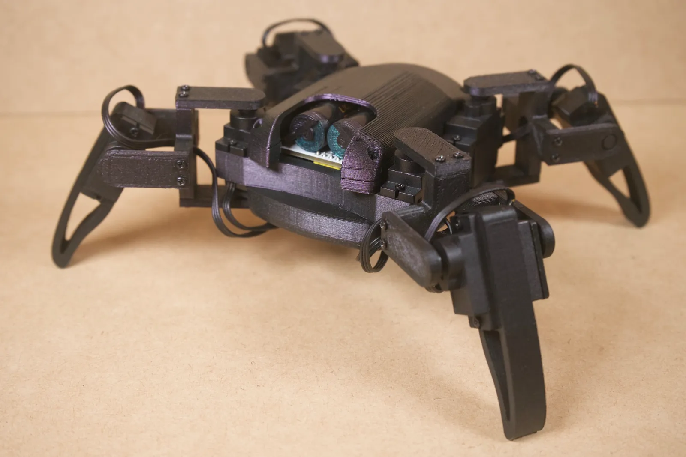
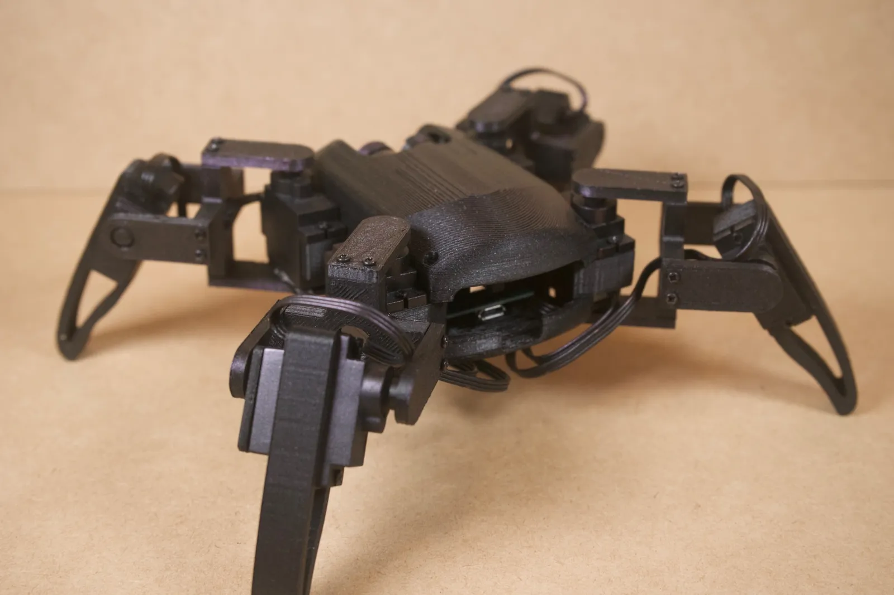

#  Spider Quadruped Robot | ESP32 Powered 8-DOF

An agile, 4-legged spider robot (quadruped) built for smooth movement and wireless control. By upgrading the classic frame with an **ESP32**, this build gains Wi-Fi and Bluetooth capabilities, making it a perfect platform for remote-controlled walking, automated routines, or STEM learning.

The robot utilizes **8 servos** (2 per leg) to achieve realistic "spider-like" articulation, including walking, rotating, and posing.

🔗 **Explore the Source Code, CAD Files & Firmware on GitHub:**  
[https://github.com/Rupesh6786/jason_mini_quadruped_robot](https://github.com/Rupesh6786/esp_quadruped_robot)

---

## 📸 Project Previews

| Assembled Quadruped | Wireframe CAD | Electronics & Servos |
| :---: | :---: | :---: |
|  |  |  |

---

## 🚀 Technical Features

* **Brain:** ESP32 Dev Board (Dual-core power for smooth servo coordination and real-time processing).
* **Movement:** 8 Degrees of Freedom (8-DOF) using MG90S metal-geared servos for extra durability and precision.
* **Power Management:** Integrated **MP1584 DC-DC Step-Down converter** to ensure stable 5V delivery, preventing the brown-outs common in DIY robotics.
* **Connectivity:** Fully controllable via a smartphone app (like RoboConnect) or custom web interface via Wi-Fi / Bluetooth.

---

## 🛠️ Bill of Materials (BOM)

| Component | Quantity | Description |
| :--- | :---: | :--- |
| **ESP32 Dev Board** | 1 | Main MCU (Wi-Fi + Bluetooth capabilities) |
| **TowerPro MG90S Servos** | 8 | High-torque metal gear servos (Hip & Knee articulation) |
| **3D Printed Parts** | 29 | Total parts for structural frame and articulated legs |
| **Fasteners** | ~60 | M1.7 x 8mm self-tapping screws for mounting servos |
| **MP1584 Converter** | 1 | Buck converter ( steps 7.4V down to stable 5V ) |
| **Battery Pack** | 2 | 18650 3.7V Li-ion cells in series (7.4V Total power) |

---

## 🔌 Pinout & Hardware Wiring

| Component / Subsystem | ESP32 GPIO / Rail | Description |
| :--- | :--- | :--- |
| **MP1584 Buck Converter** | 7.4V In (Battery Pack) | Input power source |
| **Stable 5V Rail** | MP1584 Out $\rightarrow$ Servos / ESP32 | Regulated power bus |
| **Front-Right Hip Servo** | GPIO 13 | PWM Control Signal |
| **Front-Right Knee Servo**| GPIO 12 | PWM Control Signal |
| **Front-Left Hip Servo** | GPIO 14 | PWM Control Signal |
| **Front-Left Knee Servo** | GPIO 27 | PWM Control Signal |
| **Rear-Right Hip Servo** | GPIO 26 | PWM Control Signal |
| **Rear-Right Knee Servo** | GPIO 25 | PWM Control Signal |
| **Rear-Left Hip Servo** | GPIO 33 | PWM Control Signal |
| **Rear-Left Knee Servo** | GPIO 32 | PWM Control Signal |

---

## 🖨️ Assembly & Print Tips

* **Print Settings:** Recommended **PLA, PETG, or ABS** with at least **3 perimeters/walls** to ensure strong structural rigidity around joint pins and load-bearing links.
* **Infill:** **15% – 20%** (**Gyroid** infill recommended for optimal vibration resistance and mechanical strength).
* **Calibration & Safety:** **Crucial:** Ensure the MP1584 buck output is tuned to exactly **5.0V** using a multimeter *before* connecting your servos or ESP32 to prevent hardware damage!
* **Cable Management:** Use small zip ties to route servo wires cleanly along the leg segments to prevent pinching or catching during multi-axis movement.

---

## 📁 Repository Folder Structure

```text
esp_quadruped_robot/
├── 📁 cad/
│   └── Quadruped_Assembly.f3d
├── 📁 stl/
│   └── [All 29 3D Printed STL parts]
├── 📁 firmware/
│   └── esp_quadruped_robot.ino
├── image1.png
├── image2.png
├── image3.png
└── README.md

```

---

## 🙏 Attribution & Credits

The 3D geometry and mechanical kinematics for this build are based on the fantastic open-source design by **RegisHsu**. This customized version focuses on advanced electronics integration, custom firmware optimization, and high-efficiency power management using the ESP32 ecosystem.

---

## 👤 Author

**Rupesh H. Thakur**

🔗 [GitHub – @Rupesh6786](https://github.com/Rupesh6786)

📧 Email: 55rupeshthakur@gmail.com

---

## 📄 License

This project is licensed under the **MIT License**.

See the [LICENSE](https://www.google.com/search?q=https://github.com/Rupesh6786/esp_quadruped_robot/blob/main/LICENSE) file for more information.

---
